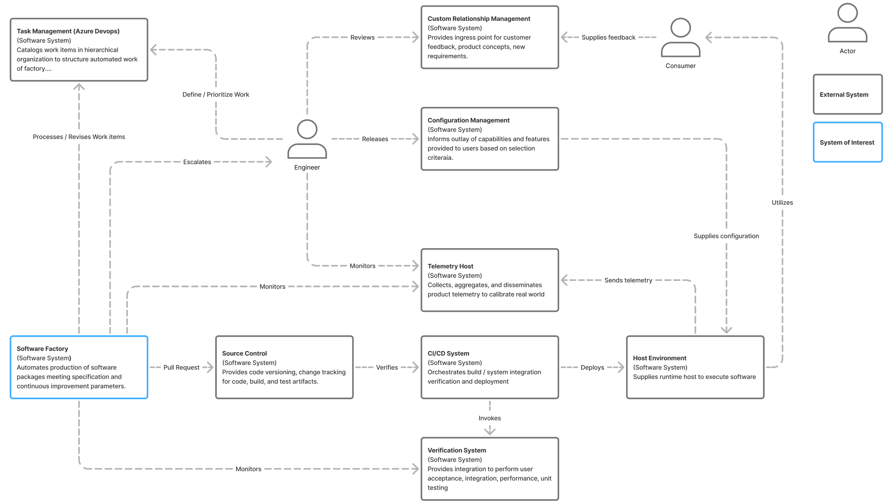

# Project Scope

This project builds the **software factory framework**: the capabilities for defining production lines, binding them to plants, and coordinating production work.

**genUI** is the pathfinding product used to exercise that framework through a concrete production-line definition. It is a generative UI library that enables LLM orchestrators to prescribe custom views and exchange information through data transforms expressed as LLM-generated JavaScript. genUI's product behavior is separate from the factory's production machinery; its consuming orchestrators are not the factory's workers.

# Software Factory Model

A software factory is an AI-native software production operation. Engineers jointly own and evolve a **production line**: the guidance, skills, worker definitions, role assignments, workflows, and verification requirements used to manufacture and evolve a **product**.

Agents are **workers** that perform production work in assigned **roles**. A role defines a worker's responsibilities within the production line.

The production line binds to a **plant**, a collection of processing infrastructure supplying the resources and capabilities needed to execute the work. The line defines how the product is made; the plant supplies the execution infrastructure. Infrastructure-sharing cardinality remains unspecified.

The product is the enduring software offering. **Product releases** are specific versions made available to consumers under human authorization. Routine manufacturing work is autonomous; humans set direction, resolve escalations, and authorize release.

# Architecture

The architecture maps the software factory model to software components, their responsibilities, and their interactions. Domain concepts guide this work; they do not imply one component or service per concept.

The mapping establishes:

- How engineers define, share, and evolve a production line's guidance, skills, worker definitions, role assignments, workflows, and verification requirements.
- How a plant supplies execution capabilities and how a production line binds to those capabilities.
- How production work is executed and its outputs associated with the product and product release.
- How verification results and production telemetry feed corrective work, and when the factory escalates to engineers.
- How human release authorization controls exposure of the product to consumers.
- How factory components interact with the external systems shown in the system context.

Component boundaries follow these responsibilities and interactions. The mapping preserves the separation between production-line definition and plant infrastructure without assuming infrastructure-sharing cardinality.

## System Context

## Initial Plant Execution Slice

The [plant model](plant-model.md) defines the selected approach: a **.NET Workbench Host** on each VM-based workbench, using **Microsoft Agent Framework** and its **GitHub Copilot SDK integration** to run coding workers.

The coordinator delivers assignments and tracks execution. Hosts connect outbound, prepare separate workspaces, configure worker instructions and permissions, and report results. MAF supplies the agent abstraction and broader workflow facilities; Copilot owns each coding worker's reasoning/tool loop.

The initial [workbench implementation](../src/Workbench/README.md) supplies a Foundry-hosted central coordinator foundation, an outbound Windows daemon connection, a WSL MAF/Copilot worker, assignment contracts, and publishing/deployment scripts. Foundry Invocations handles the coordinator protocol; its durable state store holds machine registrations and assignment ownership. The objective is two devboxes producing independent PRs in `chieftn/productionOutput1`. Deployed verification, production workflows, and daemon service installation remain open.